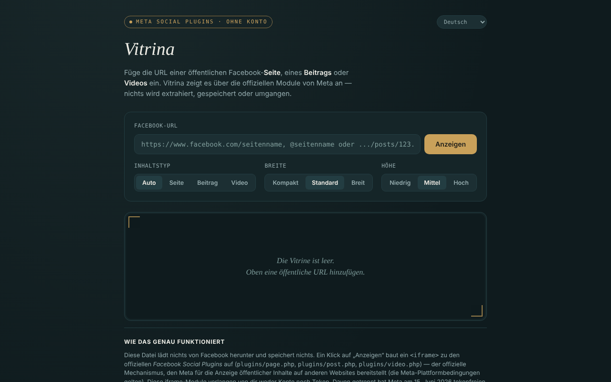

# Vitrina

[English](README.md) · [Română](README.ro.md) · [Français](README.fr.md) · [Italiano](README.it.md) · [Español](README.es.md) · [Português](README.pt.md) · **Deutsch** · [Magyar](README.hu.md)

**Version:** 1.2.2 · **Zuletzt aktualisiert:** 2026-10-22

Oberflächensprachen: **Română, English, Français, Italiano, Español, Português (PT), Deutsch, Magyar**

Zeigt öffentliche Facebook-Seiten, -Beiträge und -Videos in einer einzigen HTML-Datei über die offiziellen Module von Meta (Social Plugins), ohne Konto, in 8 Sprachen.

**Online-Anwendung:** https://chiuta.github.io/Vitrina/

## Was es ist

Sie fügen eine bereits öffentliche Facebook-URL ein, und die Anwendung baut einen `<iframe>` auf `plugins/page.php`, `plugins/post.php` oder `plugins/video.php` von `www.facebook.com`. Oberfläche: Rumänisch, Englisch, Französisch, Italienisch, Spanisch, Portugiesisch, Deutsch, Ungarisch. Es ist ein persönliches, inoffizielles Projekt ohne Verbindung zu Meta.

## Funktionen

- Automatische Erkennung des Typs (Seite / Beitrag / Video, einschließlich Reels) oder manuelle Auswahl.
- Auswahl der Breite (Kompakt 340, Standard 500, Breit 620) und der Höhe (500, 700, 900); die Breite passt sich schmalen Bildschirmen an, und das Page Plugin ist auf 500 begrenzt.
- URL-Validierung: nur `facebook.com`, `fb.watch`, `fb.com` (mit den Präfixen `www.`/`m.`/`web.`), `http(s)`, kein Benutzername/Passwort in der URL; Domains wie `facebook.com.evil.tld` oder `facebook.com@evil.tld` werden abgelehnt (mit einem automatischen Test geprüft).
- Ausdrückliche Meldung für Gruppen, Veranstaltungen und Marketplace (für deren Zeitleiste gibt es kein offizielles Modul).
- Verlauf der letzten 8 Ansichten, nur im Speicher des Tabs; ein Etikett mit Typ, Quelle und Uhrzeit sowie ein Link „auf facebook.com öffnen“ (`rel="noopener noreferrer"`).
- Das Wechseln der Sprache lädt das Embed nicht neu.
- **Namen mit @:** `@seitenname` wird als Kurzform für `https://www.facebook.com/seitenname` akzeptiert.
- Nach einer ungültigen oder leeren URL wird die Vitrine geleert, sodass das Etikett (Typ/Quelle) nicht von der vorherigen Anzeige stehen bleibt.
- **iframe-Code kopieren:** Nach der Anzeige legt eine Schaltfläche den `<iframe>`-Code, fertig zum Einfügen in die eigene Website, in die Zwischenablage (funktioniert auch ohne Netzwerk).
- **Vitrina-Link:** „Vitrina-Link kopieren“ erzeugt einen Link mit `#u=…` (URL, Typ, Breite, Höhe). Beim Öffnen **füllt** der Link die Felder nur **vor**; es wird nichts von Meta geladen, bis Sie „Anzeigen“ drücken. Der Teil nach `#` wird an keinen Server gesendet.
- **Tolerantes Einfügen:** Fügen Sie einen ganzen Text ein (z. B. eine Teilen-Nachricht), wird die erste URL von facebook.com / fb.watch / fb.com extrahiert; Tracking-Parameter (`fbclid`, `mibextid`, `utm_*` usw.) werden vor der Anzeige aus der URL entfernt.

## Verwendung

1. Kopieren Sie die URL einer öffentlichen Facebook-Seite, eines öffentlichen Beitrags oder Videos.
2. Fügen Sie sie in das Feld „Facebook-URL“ ein und drücken Sie „Anzeigen“.
3. Wählen Sie optional vor der Anzeige Typ, Breite und Höhe.
4. Um eine URL erneut zu sehen, klicken Sie sie unter „In dieser Sitzung angesehen“ an.
5. „Vitrine leeren“ löscht die Anzeige.
6. Bleibt die Vitrine leer, kann ein Werbeblocker oder Meta die Anzeige verweigern (zum Beispiel, indem eine Anmeldung verlangt wird); verwenden Sie den Link „auf facebook.com öffnen“.

## Datenschutz und Netzwerk

**Ohne Konto ≠ ohne Tracking.**

- Speicherung: `localStorage`, `sessionStorage`, Cookies und IndexedDB werden nicht verwendet; der Verlauf existiert nur im Speicher des Tabs.
- Kontaktierter Host, nur beim Drücken von „Anzeigen“: `www.facebook.com` (der iframe des Moduls). Meta erhält Ihre IP-Adresse, Ihre Browserdaten und die angesehene URL und kann gemäß ihren Richtlinien Cookies im iframe setzen. Der gesendete Referrer ist auf den Ursprung beschränkt (`strict-origin-when-cross-origin`).
- Die Seite hat eine CSP-Richtlinie (`meta http-equiv`), die Frames nur zu `facebook.com` erlaubt; das eigene Skript ist per SHA-256-Hash autorisiert (kein `'unsafe-inline'` in `script-src`); es gibt keine externen Skripte oder Ressourcen. Das tatsächliche Laden der Meta-Module konnte aus der Entwicklungsumgebung nicht getestet werden (kein Netzwerkzugang).
- Keine Analysen; die Anwendung sendet keine Daten anderswohin. Sie verlangt keine Browserberechtigungen.

## Grenzen und Hinweise

- Die iframe-Module haben von Ihnen nie ein Token verlangt; unabhängig davon hat Meta am 15. Juni 2026 den tokenlosen Zugriff auf die oEmbed-APIs angekündigt (Vitrina verwendet sie nicht) — laut dem Entwicklerblog von Meta zum Zeitpunkt der Erstellung; prüfen Sie die offizielle Dokumentation.
- Es gelten die Meta-Plattformbedingungen; verwenden Sie die Module nur zur Anzeige.
- Facebook kann eine Anmeldung verlangen oder die Anzeige mancher Inhalte verweigern; was zu sehen ist, hängt von Meta ab, nicht von der Anwendung.
- Beiträge aus öffentlichen Gruppen/Veranstaltungen sind mit „von Meta nicht offiziell bestätigt“ gekennzeichnet.
- Die Embeds sind nicht per `sandbox` isoliert (es konnte nicht getestet werden, wie die Meta-Module in einer Sandbox funktionieren).

## Lokal / offline ausführen

Laden Sie `index.html` herunter und öffnen Sie sie in einem Browser. Ohne Internet lädt die Oberfläche, aber die Embeds werden nicht angezeigt.

## Lizenz

MIT — siehe die Datei LICENSE (die README besagte zuvor, die Lizenz sei nicht deklariert, obwohl die Datei im Repository existiert).

## Autor

Alexio — Alexandru-Ionuț Chiuță, Kontakt: alexio@trom.tf

## Zusammenfassung

Vitrina („Schaufenster“) ist eine Einzeldatei-Seite, die öffentliche Facebook-Seiten, -Beiträge und -Videos über die offiziellen Social-Plugins-iframes von Meta anzeigt, ohne Konto, in 8 Sprachen. Die URL wird validiert (nur facebook.com / fb.watch / fb.com, keine Zugangsdaten). Nichts wird gespeichert, keine Analysen, aber Meta lädt den Inhalt direkt und sieht daher Ihre IP und die angesehene URL: ohne Konto ist nicht dasselbe wie ohne Tracking. Lizenz: MIT, siehe LICENSE.

## Am 11.10.2026 geprüfte Quellen

- Meta-Ankündigung vom 15. Juni 2026 zum tokenlosen Zugriff auf die oEmbed-APIs: https://developers.facebook.com/blog/post/2026/06/15/tokenless-access-to-meta-oembed-apis/ (Existenz der Ankündigung bestätigt; Vitrina verwendet oEmbed nicht).

## Verlauf / Changelog

### 1.2.2 — 2026-10-22
- fff-kit 1.1.2: PBKDF2 mit 600.000 Iterationen, Schutz vor Clickjacking.

### 1.2.1 — 2026-10-22
- Erkennung fehlgeschlagener Einbettung: Meldet der Meta-Frame nicht innerhalb von 12 Sekunden das Laden, erscheint eine Meldung (Blocker, nicht öffentliche Seite oder keine Antwort) mit direktem Link zu facebook.com.
- Mobil: kein Text unter 12 px und Touch-Ziele von mindestens 24 px (WCAG 2.5.8).

- 1.1.0 — 2026-10-14: Sicherungskopie und Datenkennzeichnung (fff-kit).

- 1.0.0 — 2026-10-12: Version und Datum der letzten Aktualisierung werden in der Anwendung angezeigt
- **11. Oktober 2026** (Runde 7) — `script-src` per Hash statt `'unsafe-inline'`; `@seitenname` akzeptiert; nach ungültiger/leerer URL wird die Vitrine geleert (kein veraltetes Etikett); Platzhalter in 7 Sprachen aktualisiert; getestet (0 Fehler, axe 0 Verstöße bei 1280×800 und 360×740).
- **11. Oktober 2026** — Schaltflächen „iframe-Code kopieren“ und „Vitrina-Link kopieren“ (Vorausfüllung über `#u=`, kein automatisches Laden), URL-Extraktion aus eingefügtem Text und Entfernen von Tracking-Parametern; Texte in den 7 Sprachen; getestet (0 JS-Fehler, axe-core 0 Verstöße bei 1280×800 und 360×740).
- **11. Oktober 2026** — der Seiteninhalt ist jetzt in ein `<main>`-Landmark eingefasst (header / main / footer), daher meldet axe-core 0 Verstöße bei 1280×800 und 360×740; README an die vorhandene LICENSE-Datei angeglichen; geprüft, dass die Anzeige eines Embeds den iframe aufbaut und keine JS-Fehler auftreten. Die Anwendung hatte keine Versionsnummer.
