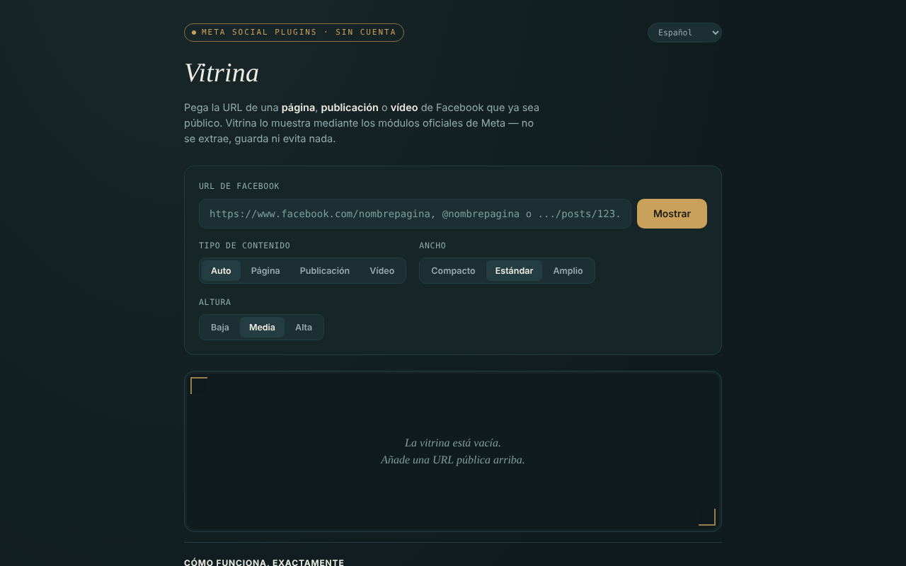

# Vitrina

[English](README.md) · [Română](README.ro.md) · [Français](README.fr.md) · [Italiano](README.it.md) · **Español** · [Português](README.pt.md) · [Deutsch](README.de.md) · [Magyar](README.hu.md)

**Versión:** 1.2.6 · **Última actualización:** 2026-10-26

Idiomas de la interfaz: **Română, English, Français, Italiano, Español, Português (PT), Deutsch, Magyar**

Muestra páginas, publicaciones y vídeos públicos de Facebook en un único archivo HTML, mediante los módulos oficiales de Meta (Social Plugins), sin cuenta, en 8 idiomas.

**Aplicación en línea:** https://chiuta.github.io/Vitrina/

## Qué es

Pegas una URL de Facebook que ya es pública y la aplicación construye un `<iframe>` hacia `plugins/page.php`, `plugins/post.php` o `plugins/video.php` de `www.facebook.com`. Interfaz: rumano, inglés, francés, italiano, español, portugués, alemán, húngaro. Es un proyecto personal, no oficial, sin relación con Meta.

## Funciones

- Detección automática del tipo (página / publicación / vídeo, incluidos los reels), o elección manual.
- Elección del ancho (Compacto 340, Estándar 500, Amplio 620) y de la altura (500, 700, 900); el ancho se adapta a las pantallas estrechas, y el Page Plugin está limitado a 500.
- Validación de la URL: solo `facebook.com`, `fb.watch`, `fb.com` (con los prefijos `www.`/`m.`/`web.`), `http(s)`, sin usuario/contraseña en la URL; dominios como `facebook.com.evil.tld` o `facebook.com@evil.tld` se rechazan (verificado con una prueba automática).
- Mensaje explícito para Grupos, Eventos y Marketplace (no existe un módulo oficial para su cronología).
- Historial de las últimas 8 visualizaciones, solo en la memoria de la pestaña; una etiqueta con el tipo, la fuente y la hora, más un enlace «abrir en facebook.com» (`rel="noopener noreferrer"`).
- El cambio de idioma no recarga el embed.
- **Nombres con @:** `@nombrepagina` se acepta como abreviatura de `https://www.facebook.com/nombrepagina`.
- Tras una URL no válida o vacía, la vitrina se vacía, de modo que la etiqueta (tipo/fuente) no permanece de la visualización anterior.
- **Copiar el código iframe:** tras la visualización, un botón pone en el portapapeles el código `<iframe>` listo para pegar en tu propio sitio (funciona también sin red).
- **Enlace de Vitrina:** «copiar el enlace de Vitrina» produce un enlace con `#u=…` (URL, tipo, ancho, altura). Al abrirlo, el enlace solo **rellena de antemano** los campos; no se carga nada de Meta hasta que pulses «Mostrar». La parte posterior a `#` no se envía a ningún servidor.
- **Pegado tolerante:** si pegas un texto entero (p. ej., un mensaje para compartir), se extrae la primera URL de facebook.com / fb.watch / fb.com; los parámetros de seguimiento (`fbclid`, `mibextid`, `utm_*`, etc.) se eliminan de la URL antes de mostrarla.

## Cómo se usa

1. Copia la URL de una página, publicación o vídeo de Facebook que sea público.
2. Pégala en el campo «URL de Facebook» y pulsa «Mostrar».
3. Opcionalmente, elige el tipo, el ancho y la altura antes de mostrar.
4. Para volver a ver una URL, púlsala en «Vistas en esta sesión».
5. «vaciar la vitrina» borra lo mostrado.
6. Si la vitrina queda vacía, un bloqueador de anuncios o Meta pueden negarse a mostrarla (por ejemplo, exigiendo autenticación); usa el enlace «abrir en facebook.com».

## Privacidad y red

**Sin cuenta ≠ sin rastreo.**

- Almacenamiento: no se usan `localStorage`, `sessionStorage`, cookies ni IndexedDB; el historial solo existe en la memoria de la pestaña.
- Host contactado, solo al pulsar «Mostrar»: `www.facebook.com` (el iframe del módulo). Meta recibe tu dirección IP, los datos de tu navegador y la URL visualizada, y puede establecer cookies en el iframe, según sus políticas. El Referrer enviado se limita al origen (`strict-origin-when-cross-origin`).
- La página tiene una política CSP (`meta http-equiv`) que permite marcos solo hacia `facebook.com`; su propio script está autorizado mediante un hash SHA-256 (sin `'unsafe-inline'` en `script-src`); no tiene scripts ni recursos externos. La carga real de los módulos de Meta no pudo probarse desde el entorno de desarrollo (sin acceso a la red).
- Sin analítica; la aplicación no envía datos a ningún otro sitio. No solicita permisos del navegador.

## Límites y advertencias

- Los módulos iframe nunca han exigido un token de tu parte; por separado, Meta anunció el 15 de junio de 2026 el acceso sin token a las API oEmbed (Vitrina no las usa) — según el blog para desarrolladores de Meta, en la fecha de redacción; consulta la documentación oficial.
- Se aplican las Condiciones de la plataforma de Meta; usa los módulos solo para mostrar contenido.
- Facebook puede exigir autenticación o negarse a mostrar algunos contenidos; lo que se ve depende de Meta, no de la aplicación.
- Las publicaciones de Grupos/Eventos públicos se marcan «no confirmado oficialmente por Meta».
- Los embeds no están aislados con `sandbox` (no se pudo probar el funcionamiento de los módulos de Meta en un sandbox).

## Ejecución local / sin conexión

Descarga `index.html` y ábrelo en un navegador. Sin internet la interfaz se carga, pero los embeds no se muestran.

## Licencia

MIT — véase el archivo LICENSE (el README decía antes que la licencia no estaba declarada, aunque el archivo existe en el repositorio).

## Autor

Alexio — Alexandru-Ionuț Chiuță, contacto: alexio@trom.tf

## Resumen

Vitrina («escaparate») es una página de un único archivo que muestra páginas, publicaciones y vídeos públicos de Facebook mediante los iframes oficiales de los Social Plugins de Meta, sin cuenta, en 8 idiomas. La URL se valida (solo facebook.com / fb.watch / fb.com, sin credenciales). No se almacena nada, no hay analítica, pero Meta carga directamente el contenido, por lo que ve tu IP y la URL que visualizas: sin cuenta no es lo mismo que sin rastreo. Licencia: MIT, véase LICENSE.

## Fuentes verificadas el 11.10.2026

- Anuncio de Meta del 15 de junio de 2026 sobre el acceso sin token a las API oEmbed: https://developers.facebook.com/blog/post/2026/06/15/tokenless-access-to-meta-oembed-apis/ (existencia del anuncio confirmada; Vitrina no usa oEmbed).

## Historial / Changelog

### 1.2.5 — 2026-10-23
- Un texto pegado que contenga p. ej. `https://evilfacebook.com/foo` ya no carga `facebook.com/foo` (la URL solo se toma cuando `facebook.com`/`fb.watch`/`fb.com` es un nombre de host completo).
- En pantallas táctiles (`pointer: coarse`) el selector de idioma, los botones y las etiquetas del historial tienen un área táctil de 44 px.

### 1.2.3 — 2026-10-22
- fff-kit 1.1.4: objetivos táctiles y texto mínimo

### 1.2.2 — 2026-10-22
- fff-kit 1.1.2: PBKDF2 con 600.000 iteraciones, protección anti-clickjacking.

### 1.2.1 — 2026-10-22
- Detección de fallo del embed: si el marco de Meta no informa de su carga en 12 segundos, aparece un mensaje (bloqueador, página no pública o sin respuesta) con un enlace directo a facebook.com.
- Móvil: ningún texto por debajo de 12 px y áreas táctiles de al menos 24 px (WCAG 2.5.8).

- 1.1.0 — 2026-10-14: copia de seguridad y etiquetado de datos (fff-kit).

- 1.0.0 — 2026-10-12: la versión y la fecha de la última actualización se muestran en la aplicación
- **11 de octubre de 2026** (ronda 7) — `script-src` con hash en lugar de `'unsafe-inline'`; `@nombrepagina` aceptado; tras una URL no válida/vacía la vitrina se vacía (sin etiqueta obsoleta); marcador de posición actualizado en 7 idiomas; probado (0 errores, axe 0 infracciones a 1280×800 y 360×740).
- **11 de octubre de 2026** — botones «copiar el código iframe» y «copiar el enlace de Vitrina» (rellenado previo mediante `#u=`, sin carga automática), extracción de la URL del texto pegado y eliminación de los parámetros de seguimiento; textos en los 7 idiomas; probado (0 errores JS, axe-core 0 infracciones a 1280×800 y 360×740).
- **11 de octubre de 2026** — el contenido de la página está ahora envuelto en una región `<main>` (header / main / footer), por lo que axe-core da 0 infracciones a 1280×800 y 360×740; README alineado con el archivo LICENSE existente; verificado que mostrar un embed construye el iframe y que no aparecen errores JS. La aplicación no tenía número de versión.
