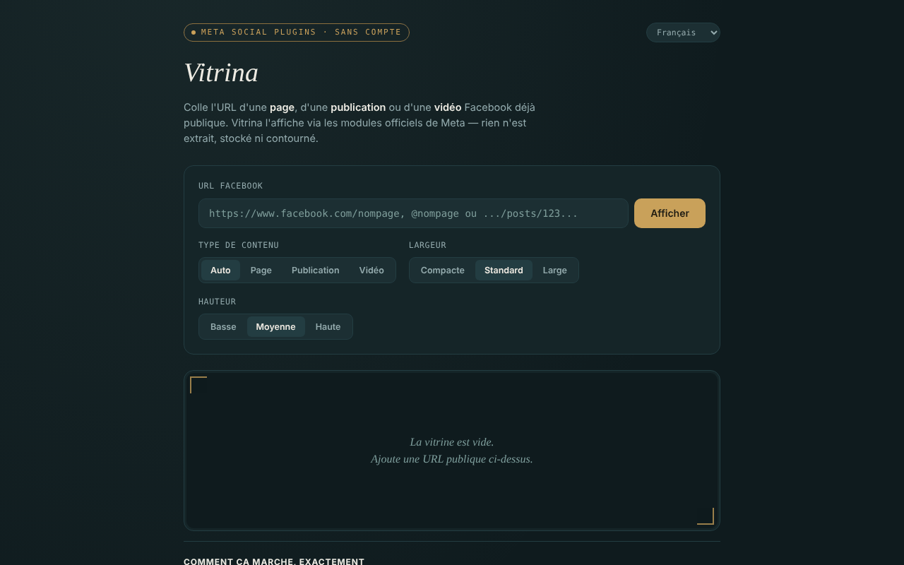

# Vitrina

[English](README.md) · [Română](README.ro.md) · **Français** · [Italiano](README.it.md) · [Español](README.es.md) · [Português](README.pt.md) · [Deutsch](README.de.md) · [Magyar](README.hu.md)

**Version :** 1.2.6 · **Dernière mise à jour :** 2026-10-26

Langues de l'interface : **Română, English, Français, Italiano, Español, Português (PT), Deutsch, Magyar**

Affiche des pages, publications et vidéos Facebook publiques dans un seul fichier HTML, via les modules officiels de Meta (Social Plugins), sans compte, en 8 langues.

**Application en ligne :** https://chiuta.github.io/Vitrina/

## De quoi s'agit-il

Vous collez une URL Facebook déjà publique, et l'application construit un `<iframe>` vers `plugins/page.php`, `plugins/post.php` ou `plugins/video.php` sur `www.facebook.com`. Interface : roumain, anglais, français, italien, espagnol, portugais, allemand, hongrois. C'est un projet personnel, non officiel, sans lien avec Meta.

## Fonctions

- Détection automatique du type (page / publication / vidéo, y compris les reels), ou choix manuel.
- Choix de la largeur (Compact 340, Standard 500, Large 620) et de la hauteur (500, 700, 900) ; la largeur s'adapte aux écrans étroits, et le Page Plugin est limité à 500.
- Validation de l'URL : uniquement `facebook.com`, `fb.watch`, `fb.com` (avec les préfixes `www.`/`m.`/`web.`), `http(s)`, sans identifiant/mot de passe dans l'URL ; des domaines tels que `facebook.com.evil.tld` ou `facebook.com@evil.tld` sont rejetés (vérifié par un test automatique).
- Message explicite pour les Groupes, Événements et Marketplace (il n'existe pas de module officiel pour leur fil).
- Historique des 8 dernières consultations, uniquement dans la mémoire de l'onglet ; une étiquette avec le type, la source et l'heure, plus un lien « ouvrir sur facebook.com » (`rel="noopener noreferrer"`).
- Le changement de langue ne recharge pas l'embed.
- **Noms avec @ :** `@nomdelapage` est accepté comme raccourci de `https://www.facebook.com/nomdelapage`.
- Après une URL invalide ou vide, la vitrine est vidée, afin que l'étiquette (type/source) ne subsiste pas de l'affichage précédent.
- **Copier le code iframe :** après l'affichage, un bouton place dans le presse-papiers le code `<iframe>` prêt à coller dans votre propre site (fonctionne aussi sans réseau).
- **Lien Vitrina :** « copier le lien de Vitrina » produit un lien avec `#u=…` (URL, type, largeur, hauteur). Une fois ouvert, le lien se contente de **préremplir** les champs ; rien n'est chargé depuis Meta tant que vous n'appuyez pas sur « Afficher ». La partie après `#` n'est envoyée à aucun serveur.
- **Collage tolérant :** si vous collez un texte entier (par ex. un message de partage), la première URL facebook.com / fb.watch / fb.com est extraite ; les paramètres de suivi (`fbclid`, `mibextid`, `utm_*`, etc.) sont retirés de l'URL avant l'affichage.

## Mode d'emploi

1. Copiez l'URL d'une page, d'une publication ou d'une vidéo Facebook qui est publique.
2. Collez-la dans le champ « URL Facebook » et appuyez sur « Afficher ».
3. En option, choisissez le type, la largeur et la hauteur avant l'affichage.
4. Pour revoir une URL, cliquez dessus dans « Consultées durant cette session ».
5. « vider la vitrine » efface l'affichage.
6. Si la vitrine reste vide, un bloqueur de publicités ou Meta peut refuser l'affichage (par exemple en exigeant une authentification) ; utilisez le lien « ouvrir sur facebook.com ».

## Confidentialité et réseau

**Sans compte ≠ sans pistage.**

- Stockage : on n'utilise ni `localStorage`, ni `sessionStorage`, ni cookies, ni IndexedDB ; l'historique n'existe que dans la mémoire de l'onglet.
- Hôte contacté, uniquement lorsque vous appuyez sur « Afficher » : `www.facebook.com` (l'iframe du module). Meta reçoit votre adresse IP, les données de votre navigateur et l'URL consultée, et peut déposer des cookies dans l'iframe, conformément à ses politiques. Le Referrer envoyé est limité à l'origine (`strict-origin-when-cross-origin`).
- La page comporte une politique CSP (`meta http-equiv`) qui n'autorise les cadres que vers `facebook.com` ; son propre script est autorisé par un hash SHA-256 (sans `'unsafe-inline'` dans `script-src`) ; elle n'a ni scripts ni ressources externes. Le chargement réel des modules Meta n'a pas pu être testé depuis l'environnement de développement (sans accès au réseau).
- Aucune analytique ; l'application n'envoie de données nulle part ailleurs. Elle ne demande aucune autorisation au navigateur.

## Limites et avertissements

- Les modules iframe n'ont jamais exigé de jeton de votre part ; par ailleurs, Meta a annoncé le 15 juin 2026 un accès sans jeton aux API oEmbed (Vitrina ne les utilise pas) — d'après le blog des développeurs de Meta, à la date de rédaction ; consultez la documentation officielle.
- Les Conditions de la plateforme Meta s'appliquent ; n'utilisez les modules que pour l'affichage.
- Facebook peut exiger une authentification ou refuser l'affichage de certains contenus ; ce que vous voyez dépend de Meta, pas de l'application.
- Les publications de Groupes/Événements publics sont marquées « non confirmé officiellement par Meta ».
- Les embeds ne sont pas isolés par `sandbox` (il n'a pas été possible de tester le fonctionnement des modules Meta dans un sandbox).

## Exécution locale / hors ligne

Téléchargez `index.html` et ouvrez-le dans un navigateur. Sans internet, l'interface se charge, mais les embeds ne s'affichent pas.

## Licence

MIT — voir le fichier LICENSE (le README indiquait auparavant que la licence n'était pas déclarée, alors que le fichier existe dans le dépôt).

## Auteur

Alexio — Alexandru-Ionuț Chiuță, contact : alexio@trom.tf

## Résumé

Vitrina (« vitrine ») est une page en un seul fichier qui affiche des pages, publications et vidéos Facebook publiques via les iframes officielles des Social Plugins de Meta, sans compte, en 8 langues. L'URL est validée (facebook.com / fb.watch / fb.com uniquement, sans identifiants). Rien n'est stocké, aucune analytique, mais Meta charge directement le contenu et voit donc votre IP et l'URL consultée : sans compte n'est pas synonyme de sans pistage. Licence : MIT, voir LICENSE.

## Sources vérifiées le 11.10.2026

- Annonce de Meta du 15 juin 2026 sur l'accès sans jeton aux API oEmbed : https://developers.facebook.com/blog/post/2026/06/15/tokenless-access-to-meta-oembed-apis/ (existence de l'annonce confirmée ; Vitrina n'utilise pas oEmbed).

## Historique / Changelog

### 1.2.5 — 2026-10-23
- Un texte collé contenant par ex. `https://evilfacebook.com/foo` ne charge plus `facebook.com/foo` (l'URL n'est retenue que si `facebook.com`/`fb.watch`/`fb.com` est un nom d'hôte entier).
- Sur écrans tactiles (`pointer: coarse`), le sélecteur de langue, les boutons et les étiquettes d'historique ont une cible tactile de 44 px.

### 1.2.3 — 2026-10-22
- fff-kit 1.1.4 : cibles tactiles et taille de texte minimale

### 1.2.2 — 2026-10-22
- fff-kit 1.1.2 : PBKDF2 à 600 000 itérations, protection anti-clickjacking.

### 1.2.1 — 2026-10-22
- Détection d'échec de l'embed : si le cadre Meta ne signale pas son chargement en 12 secondes, un message apparaît (bloqueur, page non publique ou absence de réponse) avec un lien direct vers facebook.com.
- Mobile : aucun texte sous 12 px et cibles tactiles d'au moins 24 px (WCAG 2.5.8).

- 1.1.0 — 2026-10-14 : sauvegarde et étiquetage des données (fff-kit).

- 1.0.0 — 2026-10-12 : la version et la date de dernière mise à jour sont affichées dans l'application
- **11 octobre 2026** (tour 7) — `script-src` sur hash au lieu de `'unsafe-inline'` ; `@nomdelapage` accepté ; après une URL invalide/vide la vitrine est vidée (plus d'étiquette périmée) ; texte indicatif mis à jour dans les 7 langues ; testé (0 erreur, axe 0 violation à 1280×800 et 360×740).
- **11 octobre 2026** — boutons « copier le code iframe » et « copier le lien de Vitrina » (préremplissage via `#u=`, sans chargement automatique), extraction de l'URL à partir du texte collé et retrait des paramètres de suivi ; textes dans les 7 langues ; testé (0 erreur JS, axe-core 0 violation à 1280×800 et 360×740).
- **11 octobre 2026** — le contenu de la page est désormais encadré par un repère `<main>` (header / main / footer), donc axe-core donne 0 violation à 1280×800 et 360×740 ; README aligné sur le fichier LICENSE existant ; vérifié que l'affichage d'un embed construit l'iframe et qu'aucune erreur JS n'apparaît. L'application n'avait pas de numéro de version.
