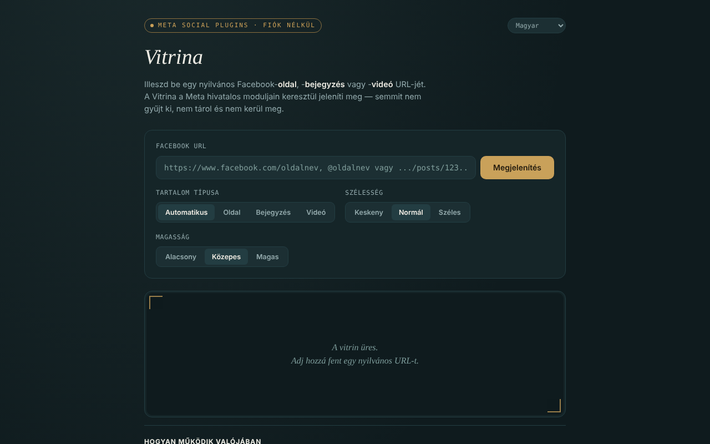

# Vitrina

[English](README.md) · [Română](README.ro.md) · [Français](README.fr.md) · [Italiano](README.it.md) · [Español](README.es.md) · [Português](README.pt.md) · [Deutsch](README.de.md) · **Magyar**

**Verzió:** 1.2.5 · **Utolsó frissítés:** 2026-10-23

A felület nyelvei: **Română, English, Français, Italiano, Español, Português (PT), Deutsch, Magyar**

Nyilvános Facebook-oldalakat, bejegyzéseket és videókat jelenít meg egyetlen HTML-fájlban, a Meta hivatalos moduljain (Social Plugins) keresztül, fiók nélkül, 8 nyelven.

**Online alkalmazás:** https://chiuta.github.io/Vitrina/

## Mi ez

Beillesztesz egy már nyilvános Facebook-URL-t, az alkalmazás pedig `<iframe>`-et épít a `www.facebook.com` `plugins/page.php`, `plugins/post.php` vagy `plugins/video.php` címére. Felület: román, angol, francia, olasz, spanyol, portugál, német, magyar. Személyes, nem hivatalos projekt, a Metához semmi köze.

## Funkciók

- A típus automatikus felismerése (oldal / bejegyzés / videó, a reelsekkel együtt), vagy kézi választás.
- A szélesség (Kompakt 340, Normál 500, Széles 620) és a magasság (500, 700, 900) megválasztása; a szélesség alkalmazkodik a keskeny képernyőkhöz, a Page Plugin pedig 500-ra korlátozott.
- URL-ellenőrzés: csak `facebook.com`, `fb.watch`, `fb.com` (a `www.`/`m.`/`web.` előtagokkal), `http(s)`, az URL-ben nem lehet felhasználónév/jelszó; az olyan domainek, mint a `facebook.com.evil.tld` vagy a `facebook.com@evil.tld`, elutasításra kerülnek (automatikus teszttel ellenőrizve).
- Kifejezett üzenet a Csoportokhoz, Eseményekhez és a Marketplace-hez (az idővonalukhoz nincs hivatalos modul).
- Az utolsó 8 megtekintés előzményei, kizárólag a lap memóriájában; címke a típussal, a forrással és az idővel, valamint egy „megnyitás a facebook.com-on” hivatkozás (`rel="noopener noreferrer"`).
- A nyelv váltása nem tölti újra a beágyazást.
- **@-os nevek:** az `@oldalneve` a `https://www.facebook.com/oldalneve` rövidítéseként elfogadott.
- Érvénytelen vagy üres URL után a vitrin kiürül, így a címke (típus/forrás) nem marad meg az előző megjelenítésből.
- **Az iframe-kód másolása:** megjelenítés után egy gomb a vágólapra teszi a saját weboldaladba illeszthető `<iframe>`-kódot (hálózat nélkül is működik).
- **Vitrina-hivatkozás:** a „Vitrina-hivatkozás másolása” egy `#u=…` részt tartalmazó hivatkozást állít elő (URL, típus, szélesség, magasság). Megnyitáskor a hivatkozás csak **előre kitölti** a mezőket; a Metától semmi nem töltődik be, amíg meg nem nyomod a „Megjelenítés” gombot. A `#` utáni részt egyetlen szerver sem kapja meg.
- **Megengedő beillesztés:** ha egy egész szöveget illesztesz be (pl. egy megosztási üzenetet), az első facebook.com / fb.watch / fb.com URL kinyerésre kerül; a követőparaméterek (`fbclid`, `mibextid`, `utm_*` stb.) a megjelenítés előtt eltávolításra kerülnek az URL-ből.

## Használat

1. Másold ki egy nyilvános Facebook-oldal, -bejegyzés vagy -videó URL-jét.
2. Illeszd be a „Facebook-URL” mezőbe, és nyomd meg a „Megjelenítés” gombot.
3. Igény szerint a megjelenítés előtt válaszd ki a típust, a szélességet és a magasságot.
4. Egy URL újbóli megtekintéséhez kattints rá a „Ebben a munkamenetben megtekintett” listában.
5. A „vitrin ürítése” törli a megjelenítést.
6. Ha a vitrin üres marad, egy reklámblokkoló vagy a Meta megtagadhatja a megjelenítést (például bejelentkezést kérve); használd a „megnyitás a facebook.com-on” hivatkozást.

## Adatvédelem és hálózat

**Fiók nélkül ≠ követés nélkül.**

- Tárolás: nem használ `localStorage`-et, `sessionStorage`-et, sütiket vagy IndexedDB-t; az előzmények csak a lap memóriájában léteznek.
- Felvett kapcsolatú gazdagép, csak a „Megjelenítés” megnyomásakor: `www.facebook.com` (a modul iframe-je). A Meta megkapja az IP-címedet, a böngésződ adatait és a megtekintett URL-t, és a saját szabályzatai szerint sütiket állíthat be az iframe-ben. A küldött Referrer az eredetre korlátozott (`strict-origin-when-cross-origin`).
- Az oldalon CSP-szabályzat van (`meta http-equiv`), amely csak a `facebook.com` felé engedélyez kereteket; a saját szkriptet SHA-256-hash engedélyezi (a `script-src`-ben nincs `'unsafe-inline'`); nincsenek külső szkriptek vagy erőforrások. A Meta moduljainak tényleges betöltését a fejlesztői környezetből nem lehetett tesztelni (nincs hálózati hozzáférés).
- Nincs analitika; az alkalmazás máshová nem küld adatot. Nem kér böngészőengedélyeket.

## Korlátok és figyelmeztetések

- Az iframe-modulok soha nem kértek tőled tokent; ettől függetlenül a Meta 2026. június 15-én bejelentette az oEmbed API-k tokenmentes elérését (a Vitrina nem használja őket) — a Meta fejlesztői blogja szerint, az írás időpontjában; ellenőrizd a hivatalos dokumentációt.
- A Meta Platform feltételei érvényesek; a modulokat csak megjelenítésre használd.
- A Facebook bejelentkezést kérhet, vagy megtagadhatja egyes tartalmak megjelenítését; hogy mi látszik, a Metától függ, nem az alkalmazástól.
- A nyilvános Csoportok/Események bejegyzései a „a Meta hivatalosan nem erősítette meg” jelölést kapják.
- A beágyazások nincsenek `sandbox`-szal elszigetelve (nem lehetett tesztelni, hogyan működnek a Meta moduljai sandboxban).

## Helyi / offline futtatás

Töltsd le az `index.html` fájlt, és nyisd meg egy böngészőben. Internet nélkül a felület betöltődik, de a beágyazások nem jelennek meg.

## Licenc

MIT — lásd a LICENSE fájlt (a README korábban azt állította, hogy a licenc nincs megadva, noha a fájl létezik a tárolóban).

## Szerző

Alexio — Alexandru-Ionuț Chiuță, kapcsolat: alexio@trom.tf

## Összefoglaló

A Vitrina („kirakat”) egyetlen fájlból álló oldal, amely nyilvános Facebook-oldalakat, bejegyzéseket és videókat jelenít meg a Meta hivatalos Social Plugins iframe-jein keresztül, fiók nélkül, 8 nyelven. Az URL ellenőrzött (csak facebook.com / fb.watch / fb.com, hitelesítő adatok nélkül). Semmi nem tárolódik, nincs analitika, de a Meta közvetlenül tölti be a tartalmat, így látja az IP-címedet és a megtekintett URL-t: a fiók nélküli használat nem azonos a követés nélkülivel. Licenc: MIT, lásd LICENSE.

## 2026.10.11-én ellenőrzött források

- A Meta 2026. június 15-i bejelentése az oEmbed API-k tokenmentes eléréséről: https://developers.facebook.com/blog/post/2026/06/15/tokenless-access-to-meta-oembed-apis/ (a bejelentés létezése megerősítve; a Vitrina nem használ oEmbedet).

## Előzmények / Changelog

### 1.2.5 — 2026-10-23
- A beillesztett szöveg, amely pl. `https://evilfacebook.com/foo`-t tartalmaz, már nem tölti be a `facebook.com/foo`-t (az URL-t csak akkor veszi át, ha a `facebook.com`/`fb.watch`/`fb.com` teljes gazdanév).
- Érintőképernyőn (`pointer: coarse`) a nyelvválasztó, a gombok és az előzmény-címkék 44 px-es érintési célpontot kapnak.

### 1.2.3 — 2026-10-22
- fff-kit 1.1.4: érintési célpontok és minimális szövegméret

### 1.2.2 — 2026-10-22
- fff-kit 1.1.2: PBKDF2 600 000 iterációval, clickjacking elleni védelem.

### 1.2.1 — 2026-10-22
- Beágyazási hiba felismerése: ha a Meta-keret 12 másodpercen belül nem jelzi a betöltést, üzenet jelenik meg (blokkoló, nem nyilvános oldal vagy nincs válasz) közvetlen facebook.com-hivatkozással.
- Mobil: nincs 12 px alatti szöveg, az érintési célpontok legalább 24 px-esek (WCAG 2.5.8).

- 1.1.0 — 2026-10-14: biztonsági mentés és adatcímkézés (fff-kit).

- 1.0.0 — 2026-10-12: a verzió és az utolsó frissítés dátuma megjelenik az alkalmazásban
- **2026. október 11.** (7. kör) — `script-src` hash-sel `'unsafe-inline'` helyett; az `@oldalneve` elfogadott; érvénytelen/üres URL után a vitrin kiürül (nincs elavult címke); a helyőrző szöveg frissítve 7 nyelven; tesztelve (0 hiba, axe 0 szabálysértés 1280×800 és 360×740 mellett).
- **2026. október 11.** — „az iframe-kód másolása” és „a Vitrina-hivatkozás másolása” gombok (előkitöltés `#u=`-n keresztül, automatikus betöltés nélkül), az URL kinyerése a beillesztett szövegből és a követőparaméterek eltávolítása; szövegek a 7 nyelven; tesztelve (0 JS-hiba, axe-core 0 szabálysértés 1280×800 és 360×740 mellett).
- **2026. október 11.** — az oldal tartalma mostantól `<main>` landmarkba van foglalva (header / main / footer), így az axe-core 0 szabálysértést jelez 1280×800 és 360×740 mellett; a README igazítva a meglévő LICENSE fájlhoz; ellenőrizve, hogy egy beágyazás megjelenítése felépíti az iframe-et, és nem jelentkezik JS-hiba. Az alkalmazásnak nem volt verziószáma.
