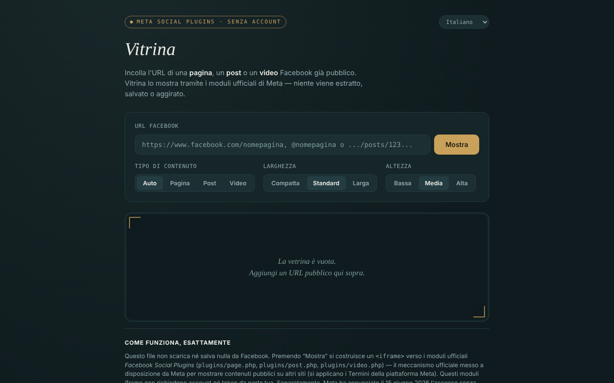

# Vitrina

[English](README.md) · [Română](README.ro.md) · [Français](README.fr.md) · **Italiano** · [Español](README.es.md) · [Português](README.pt.md) · [Deutsch](README.de.md) · [Magyar](README.hu.md)

**Versione:** 2.2.0 · **Ultimo aggiornamento:** 2026-10-27

Lingue dell'interfaccia: **Română, English, Français, Italiano, Español, Português (PT), Deutsch, Magyar**

Mostra pagine, post e video Facebook pubblici in un unico file HTML, tramite i moduli ufficiali di Meta (Social Plugins), senza account, in 8 lingue.

**Applicazione online:** https://chiuta.github.io/Vitrina/

## Che cos'è

Incolli un URL Facebook già pubblico e l'app costruisce un `<iframe>` verso `plugins/page.php`, `plugins/post.php` o `plugins/video.php` su `www.facebook.com`. Interfaccia: rumeno, inglese, francese, italiano, spagnolo, portoghese, tedesco, ungherese. È un progetto personale, non ufficiale, senza alcun legame con Meta.

## Funzioni

- Rilevamento automatico del tipo (pagina / post / video, inclusi i reel), oppure scelta manuale.
- Scelta della larghezza (Compatto 340, Standard 500, Largo 620) e dell'altezza (500, 700, 900); la larghezza si adatta agli schermi stretti e il Page Plugin è limitato a 500.
- Validazione dell'URL: solo `facebook.com`, `fb.watch`, `fb.com` (con i prefissi `www.`/`m.`/`web.`), `http(s)`, senza utente/password nell'URL; domini come `facebook.com.evil.tld` o `facebook.com@evil.tld` vengono respinti (verificato con un test automatico).
- Messaggio esplicito per Gruppi, Eventi e Marketplace (non esiste un modulo ufficiale per la loro cronologia).
- Cronologia delle ultime 8 visualizzazioni, solo nella memoria della scheda; un'etichetta con tipo, fonte e ora, più un link «apri su facebook.com» (`rel="noopener noreferrer"`).
- Il cambio di lingua non ricarica l'embed.
- **Nomi con @:** `@nomepagina` è accettato come abbreviazione di `https://www.facebook.com/nomepagina`.
- Dopo un URL non valido o vuoto, la vetrina si svuota, così l'etichetta (tipo/fonte) non resta dalla visualizzazione precedente.
- **Copia il codice iframe:** dopo la visualizzazione, un pulsante mette negli appunti il codice `<iframe>` pronto da incollare nel tuo sito (funziona anche senza rete).
- **Link Vitrina:** «copia il link di Vitrina» produce un link con `#u=…` (URL, tipo, larghezza, altezza). Una volta aperto, il link si limita a **precompilare** i campi; nulla viene caricato da Meta finché non premi «Mostra». La parte dopo `#` non viene inviata ad alcun server.
- **Incolla tollerante:** se incolli un testo intero (ad es. un messaggio di condivisione), viene estratto il primo URL facebook.com / fb.watch / fb.com; i parametri di tracciamento (`fbclid`, `mibextid`, `utm_*` ecc.) vengono rimossi dall'URL prima della visualizzazione.

## Come si usa

1. Copia l'URL di una pagina, di un post o di un video Facebook pubblico.
2. Incollalo nel campo «URL Facebook» e premi «Mostra».
3. Facoltativamente, scegli tipo, larghezza e altezza prima di mostrare.
4. Per rivedere un URL, fai clic su di esso in «Visualizzati in questa sessione».
5. «svuota la vetrina» cancella la visualizzazione.
6. Se la vetrina resta vuota, un blocco pubblicità o Meta può rifiutare la visualizzazione (ad esempio richiedendo l'autenticazione); usa il link «apri su facebook.com».

## Riservatezza e rete

**Senza account ≠ senza tracciamento.**

- Archiviazione: non si usano `localStorage`, `sessionStorage`, cookie né IndexedDB; la cronologia esiste solo nella memoria della scheda. Eccezione dalla 2.2.0: la scelta «clic per caricare», se spuntata, viene ricordata in `localStorage` (chiave `vitrina_c2l`); traduzione automatica.
- Host contattato, solo quando premi «Mostra»: `www.facebook.com` (l'iframe del modulo). Meta riceve il tuo indirizzo IP, i dati del browser e l'URL visualizzato e può impostare cookie nell'iframe, secondo le proprie politiche. Il Referrer inviato è limitato all'origine (`strict-origin-when-cross-origin`).
- La pagina ha una politica CSP (`meta http-equiv`) che consente i frame solo verso `facebook.com`; lo script proprio è autorizzato tramite hash SHA-256 (senza `'unsafe-inline'` in `script-src`); non ha script né risorse esterne. Il caricamento reale dei moduli Meta non ha potuto essere testato dall'ambiente di sviluppo (senza accesso alla rete).
- Nessuna analitica; l'app non invia dati altrove. Non richiede permessi del browser.

## Limiti e avvertenze

- I moduli iframe non hanno mai richiesto un token da parte tua; separatamente, Meta ha annunciato il 15 giugno 2026 l'accesso senza token alle API oEmbed (Vitrina non le usa) — secondo il blog degli sviluppatori di Meta, alla data di stesura; verifica la documentazione ufficiale.
- Si applicano le Condizioni della piattaforma Meta; usa i moduli solo per la visualizzazione.
- Facebook può richiedere l'autenticazione o rifiutare la visualizzazione di alcuni contenuti; ciò che si vede dipende da Meta, non dall'app.
- I post di Gruppi/Eventi pubblici sono contrassegnati «non confermato ufficialmente da Meta».
- Gli embed non sono isolati con `sandbox` (non è stato possibile testare il funzionamento dei moduli Meta in una sandbox).

## Esecuzione locale / offline

Scarica `index.html` e aprilo in un browser. Senza internet l'interfaccia si carica, ma gli embed non vengono mostrati.

## Licenza

MIT — vedi il file LICENSE (il README affermava in precedenza che la licenza non era dichiarata, benché il file esista nel repository).

## Autore

Alexio — Alexandru-Ionuț Chiuță, contatto: alexio@trom.tf

## Riepilogo

Vitrina («vetrina») è una pagina in un unico file che mostra pagine, post e video Facebook pubblici tramite gli iframe ufficiali dei Social Plugins di Meta, senza account, in 8 lingue. L'URL è validato (solo facebook.com / fb.watch / fb.com, senza credenziali). Nulla viene archiviato, nessuna analitica, ma Meta carica direttamente il contenuto e quindi vede il tuo IP e l'URL che visualizzi: senza account non significa senza tracciamento. Licenza: MIT, vedi LICENSE.

## Fonti verificate l'11.10.2026

- Annuncio di Meta del 15 giugno 2026 sull'accesso senza token alle API oEmbed: https://developers.facebook.com/blog/post/2026/06/15/tokenless-access-to-meta-oembed-apis/ (esistenza dell'annuncio confermata; Vitrina non usa oEmbed).

## Cronologia / Changelog

### 1.2.5 — 2026-10-23
- Un testo incollato che contiene ad es. `https://evilfacebook.com/foo` non carica più `facebook.com/foo` (l'URL viene preso solo se `facebook.com`/`fb.watch`/`fb.com` è un nome host intero).
- Sugli schermi tattili (`pointer: coarse`) il selettore della lingua, i pulsanti e le etichette della cronologia hanno un'area tattile di 44 px.

### 1.2.3 — 2026-10-22
- fff-kit 1.1.4: bersagli touch e testo minimo

### 1.2.2 — 2026-10-22
- fff-kit 1.1.2: PBKDF2 a 600.000 iterazioni, protezione anti-clickjacking.

### 1.2.1 — 2026-10-22
- Rilevamento del fallimento dell'embed: se il frame di Meta non segnala il caricamento entro 12 secondi, compare un messaggio (blocco, pagina non pubblica o nessuna risposta) con link diretto a facebook.com.
- Mobile: nessun testo sotto i 12 px e aree tattili di almeno 24 px (WCAG 2.5.8).

- 1.1.0 — 2026-10-14: copia di sicurezza ed etichettatura dei dati (fff-kit).

- 1.0.0 — 2026-10-12: la versione e la data dell'ultimo aggiornamento sono mostrate nell'app
- **11 ottobre 2026** (giro 7) — `script-src` su hash invece di `'unsafe-inline'`; `@nomepagina` accettato; dopo un URL non valido/vuoto la vetrina si svuota (nessuna etichetta obsoleta); placeholder aggiornato in 7 lingue; testato (0 errori, axe 0 violazioni a 1280×800 e 360×740).
- **11 ottobre 2026** — pulsanti «copia il codice iframe» e «copia il link di Vitrina» (precompilazione tramite `#u=`, nessun caricamento automatico), estrazione dell'URL dal testo incollato e rimozione dei parametri di tracciamento; testi nelle 7 lingue; testato (0 errori JS, axe-core 0 violazioni a 1280×800 e 360×740).
- **11 ottobre 2026** — il contenuto della pagina è ora racchiuso in un riferimento `<main>` (header / main / footer), quindi axe-core dà 0 violazioni a 1280×800 e 360×740; README allineato al file LICENSE esistente; verificato che la visualizzazione di un embed costruisca l'iframe e che non compaiano errori JS. L'app non aveva un numero di versione.
