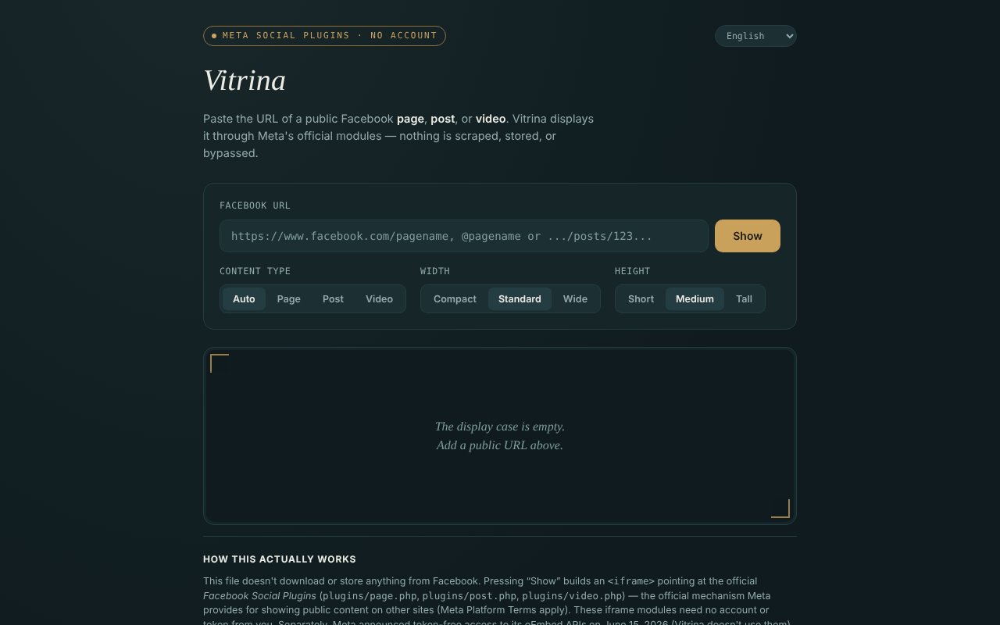

# Vitrina

**English** · [Română](README.ro.md) · [Français](README.fr.md) · [Italiano](README.it.md) · [Español](README.es.md) · [Português](README.pt.md) · [Deutsch](README.de.md) · [Magyar](README.hu.md)

**Version:** 1.2.1 · **Last updated:** 2026-10-22

Interface languages: **Română, English, Français, Italiano, Español, Português (PT), Deutsch, Magyar**

Displays public Facebook pages, posts and videos in a single HTML file, through Meta's official modules (Social Plugins), with no account, in 8 languages.

**Live app:** https://chiuta.github.io/Vitrina/

## What it is

You paste a Facebook URL that is already public, and the app builds an `<iframe>` pointing to `plugins/page.php`, `plugins/post.php` or `plugins/video.php` on `www.facebook.com`. Interface: Romanian, English, French, Italian, Spanish, Portuguese, German, Hungarian. It is a personal, unofficial project, unrelated to Meta.

## Features

- Automatic type detection (page / post / video, including reels), or manual choice.
- Choice of width (Compact 340, Standard 500, Wide 620) and height (500, 700, 900); the width adapts to narrow screens, and the Page Plugin is limited to 500.
- URL validation: only `facebook.com`, `fb.watch`, `fb.com` (with the prefixes `www.`/`m.`/`web.`), `http(s)`, no username/password in the URL; domains such as `facebook.com.evil.tld` or `facebook.com@evil.tld` are rejected (verified with an automated test).
- Explicit message for Groups, Events and Marketplace (there is no official module for their timeline).
- History of the last 8 views, kept only in the tab's memory; a label with the type, source and time, plus an "open on facebook.com" link (`rel="noopener noreferrer"`).
- Changing the language does not reload the embed.
- **@ names:** `@pagename` is accepted as shorthand for `https://www.facebook.com/pagename`.
- After an invalid or empty URL, the display case is cleared, so the label (type/source) no longer lingers from the previous display.
- **Copy iframe code:** after display, a button puts the `<iframe>` code, ready to paste into your own site, on the clipboard (it also works without a network).
- **Vitrina link:** "copy the Vitrina link" produces a link with `#u=…` (URL, type, width, height). When opened, the link only **pre-fills** the fields; nothing is loaded from Meta until you press "Display". The part after `#` is not sent to any server.
- **Tolerant paste:** if you paste a whole text (e.g. a sharing message), the first facebook.com / fb.watch / fb.com URL is extracted; tracking parameters (`fbclid`, `mibextid`, `utm_*`, etc.) are removed from the URL before display.

## How to use

1. Copy the URL of a Facebook page, post or video that is public.
2. Paste it into the "Facebook URL" field and press "Display".
3. Optionally, choose the type, width and height before displaying.
4. To view a URL again, click it under "Viewed in this session".
5. "empty the display case" clears the display.
6. If the display case stays empty, an ad blocker or Meta may refuse to display it (for example by requiring authentication); use the "open on facebook.com" link.

## Privacy and network

**No account ≠ no tracking.**

- Storage: `localStorage`, `sessionStorage`, cookies and IndexedDB are not used; the history lives only in the tab's memory.
- Host contacted, only when you press "Display": `www.facebook.com` (the module's iframe). Meta receives your IP address, your browser data and the URL being viewed, and may set cookies in the iframe, according to its policies. The Referrer sent is limited to the origin (`strict-origin-when-cross-origin`).
- The page has a CSP policy (`meta http-equiv`) that allows frames only to `facebook.com`; its own script is authorised by a SHA-256 hash (no `'unsafe-inline'` in `script-src`); it has no external scripts or resources. The actual loading of the Meta modules could not be tested from the development environment (no network access).
- No analytics; the app sends data nowhere else. It asks for no browser permissions.

## Limits and warnings

- The iframe modules have never required a token from you; separately, Meta announced on 15 June 2026 tokenless access to the oEmbed APIs (Vitrina does not use them) — according to Meta's developer blog at the time of writing; check the official documentation.
- The Meta Platform Terms apply; use the modules for display only.
- Facebook may require authentication or refuse to display some content; what you see depends on Meta, not on the app.
- Posts from public Groups/Events are marked "not officially confirmed by Meta".
- The embeds are not isolated with `sandbox` (it was not possible to test how the Meta modules work in a sandbox).

## Running locally / offline

Download `index.html` and open it in a browser. Without internet the interface loads, but the embeds are not displayed.

## License

MIT — see the LICENSE file (the README previously said the license was not declared, although the file exists in the repository).

## Author

Alexio — Alexandru-Ionuț Chiuță, contact: alexio@trom.tf

## Summary

Vitrina ("Display case") is a single-file page that shows public Facebook pages, posts and videos through Meta's official Social Plugins iframes, no account needed, in 8 languages. The URL is validated (facebook.com / fb.watch / fb.com only, no credentials). Nothing is stored, no analytics, but Meta loads the content directly, so it sees your IP and the URL you view: no account is not the same as no tracking. License: MIT, see LICENSE.

## Sources verified on 11.10.2026

- Meta's announcement of 15 June 2026 on tokenless access to the oEmbed APIs: https://developers.facebook.com/blog/post/2026/06/15/tokenless-access-to-meta-oembed-apis/ (existence of the announcement confirmed; Vitrina does not use oEmbed).

## History / Changelog

### 1.2.1 — 2026-10-22
- Embed failure detection: if the Meta frame does not report loading within 12 seconds, a message appears (blocker, non-public page or no response) with a direct link to facebook.com.
- Mobile: no text below 12 px and touch targets of at least 24 px (WCAG 2.5.8).

- 1.1.0 — 2026-10-14: Backup and data labelling (fff-kit).

- 1.0.0 — 2026-10-12: the version and the date of the last update are displayed in the app
- **11 October 2026** (round 7) — `script-src` on a hash instead of `'unsafe-inline'`; `@pagename` accepted; after an invalid/empty URL the display case is cleared (no stale label); placeholder updated in 7 languages; tested (0 errors, axe 0 violations at 1280×800 and 360×740).
- **11 October 2026** — "copy iframe code" and "copy the Vitrina link" buttons (pre-filling through `#u=`, no automatic loading), URL extraction from pasted text and removal of tracking parameters; texts in the 7 languages; tested (0 JS errors, axe-core 0 violations at 1280×800 and 360×740).
- **11 October 2026** — the page content is now wrapped in a `<main>` landmark (header / main / footer), so axe-core gives 0 violations at 1280×800 and 360×740; README aligned with the existing LICENSE file; verified that displaying an embed builds the iframe and that no JS errors appear. The app had no version number.
