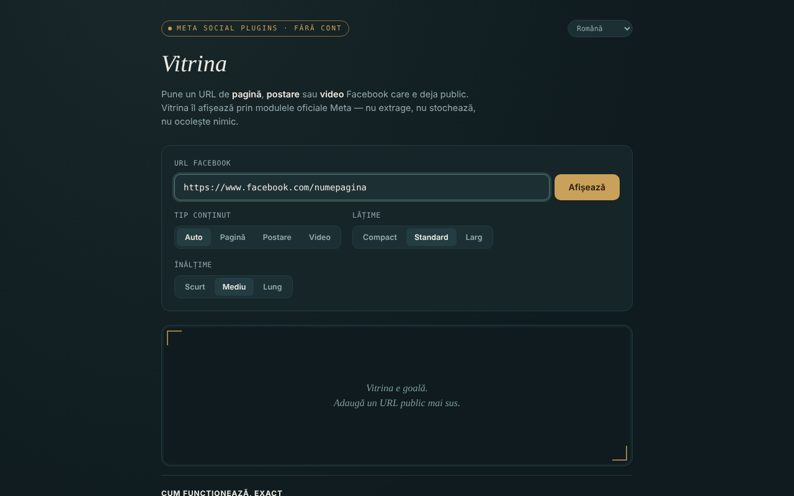

# Vitrina

Afișează pagini, postări și video-uri publice Facebook într-un singur fișier HTML, prin modulele oficiale Meta (Social Plugins), fără cont, în 7 limbi.

**Versiune:** 1.1.0 · **Ultima actualizare:** 14 octombrie 2026

**Live:** https://chiuta.github.io/Vitrina/

## Ce este

Lipești un URL Facebook deja public, iar aplicația construiește un `<iframe>` către `plugins/page.php`, `plugins/post.php` sau `plugins/video.php` de pe `www.facebook.com`. Interfața: română, engleză, franceză, italiană, spaniolă, portugheză, germană. Este un proiect personal, neoficial, fără legătură cu Meta.

## Funcții

- Detectare automată a tipului (pagină / postare / video, inclusiv reels), sau alegere manuală.
- Alegerea lățimii (Compact 340, Standard 500, Larg 620) și a înălțimii (500, 700, 900); lățimea se adaptează la ecranele înguste, iar Page Plugin este limitat la 500.
- Validarea URL-ului: doar `facebook.com`, `fb.watch`, `fb.com` (cu prefixele `www.`/`m.`/`web.`), `http(s)`, fără utilizator/parolă în URL; domenii precum `facebook.com.evil.tld` sau `facebook.com@evil.tld` sunt respinse (verificat cu test automat).
- Mesaj explicit pentru Grupuri, Evenimente și Marketplace (nu există modul oficial pentru cronologia lor).
- Istoric al ultimelor 8 vizualizări, doar în memoria filei; etichetă cu tipul, sursa și ora, plus link „deschide pe facebook.com" (`rel="noopener noreferrer"`).
- Schimbarea limbii nu reîncarcă embed-ul.
- **Nume cu @:** `@numepagina` este acceptat ca prescurtare pentru `https://www.facebook.com/numepagina`.
- După un URL invalid sau gol, vitrina se golește, astfel încât eticheta (tip/sursă) nu mai rămâne de la afișarea anterioară.
- **Copiază codul iframe:** după afișare, un buton pune în clipboard codul `<iframe>` gata de lipit în propriul site (funcționează și fără rețea).
- **Link Vitrina:** „copiază linkul Vitrinei” produce un link cu `#u=…` (URL, tip, lățime, înălțime). Deschis, linkul doar **precompletează** câmpurile; nimic nu se încarcă de la Meta până nu apeși „Afișează”. Partea după `#` nu este trimisă niciunui server.
- **Lipire tolerantă:** dacă lipești un text întreg (de ex. un mesaj de partajare), se extrage primul URL facebook.com / fb.watch / fb.com; parametrii de urmărire (`fbclid`, `mibextid`, `utm_*` etc.) sunt eliminați din URL înainte de afișare.

## Manual de utilizare

1. Copiază URL-ul unei pagini, postări sau video Facebook care este public.
2. Lipește-l în câmpul „URL Facebook" și apasă „Afișează".
3. Opțional, alege tipul, lățimea și înălțimea înainte de afișare.
4. Pentru a revedea un URL, apasă-l în „Vizualizate în această sesiune".
5. „golește vitrina" șterge afișajul.
6. Dacă vitrina rămâne goală, un blocker de reclame sau Meta poate refuza afișarea (de exemplu cere autentificare); folosește linkul „deschide pe facebook.com".

## Confidențialitate și rețea

**Fără cont ≠ fără urmărire.**

- Stocare: nu se folosește `localStorage`, `sessionStorage`, cookie-uri sau IndexedDB; istoricul e doar în memoria filei.
- Gazdă contactată, doar la apăsarea „Afișează": `www.facebook.com` (iframe-ul modulului). Meta primește adresa ta IP, datele browserului și URL-ul vizualizat și poate seta cookie-uri în iframe, potrivit politicilor ei. Referrer-ul trimis este limitat la origine (`strict-origin-when-cross-origin`).
- Pagina are o politică CSP (`meta http-equiv`) care permite cadre doar către `facebook.com`; scriptul propriu este autorizat prin hash SHA-256 (fără `'unsafe-inline'` în `script-src`); nu are scripturi sau resurse externe. Încărcarea reală a modulelor Meta nu a putut fi testată din mediul de dezvoltare (fără acces la rețea).
- Nicio analitică; aplicația nu trimite date în altă parte. Nu cere permisiuni ale browserului.

## Limite și avertismente

- Modulele iframe nu au cerut niciodată token din partea ta; separat, Meta a anunțat la 15 iunie 2026 acces fără token la API-urile oEmbed (Vitrina nu le folosește) — conform blogului Meta pentru dezvoltatori, la data scrierii; verifică documentația oficială.
- Se aplică Termenii Platformei Meta; folosește modulele doar pentru afișare.
- Facebook poate cere autentificare sau poate refuza afișarea unor conținuturi; ce se vede depinde de Meta, nu de aplicație.
- Postările din Grupuri/Evenimente publice sunt marcate „neconfirmat oficial de Meta".
- Embed-urile nu sunt izolate cu `sandbox` (nu s-a putut testa funcționarea modulelor Meta în sandbox).

## Rulare locală / offline

Descarcă `index.html` și deschide-l în browser. Fără internet interfața se încarcă, dar embed-urile nu se afișează.

## Licență

MIT — vezi fișierul LICENSE (README-ul spunea anterior că licența nu e declarată, deși fișierul există în depozit).

## Autor

Alexio — Alexandru-Ionuț Chiuță, contact: alexio@trom.tf

## English summary

Vitrina ("Display case") is a single-file page that shows public Facebook pages, posts and videos through Meta's official Social Plugins iframes, no account needed, in 7 languages. The URL is validated (facebook.com / fb.watch / fb.com only, no credentials). Nothing is stored, no analytics, but Meta loads the content directly, so it sees your IP and the URL you view: no account is not the same as no tracking. License: MIT, see LICENSE.

## Surse verificate la 11.10.2026

- Anunțul Meta din 15 iunie 2026 privind accesul fără token la API-urile oEmbed: https://developers.facebook.com/blog/post/2026/06/15/tokenless-access-to-meta-oembed-apis/ (existența anunțului confirmată; Vitrina nu folosește oEmbed).

## Istoric / Changelog

- 1.1.0 — 2026-10-14: Copie de rezervă și etichetare date (fff-kit).

- 1.0.0 — 2026-10-12: versiunea și data ultimei actualizări sunt afișate în aplicație
- **11 octombrie 2026** (runda 7) — `script-src` pe hash în loc de `'unsafe-inline'`; `@numepagina` acceptat; după URL invalid/gol vitrina se golește (fără etichetă învechită); placeholder actualizat în 7 limbi; testat (0 erori, axe 0 violări la 1280×800 și 360×740).
- **11 octombrie 2026** — butoane „copiază codul iframe” și „copiază linkul Vitrinei” (precompletare prin `#u=`, fără încărcare automată), extragerea URL-ului din text lipit și eliminarea parametrilor de urmărire; texte în cele 7 limbi; testat (0 erori JS, axe-core 0 violări la 1280×800 și 360×740).
- **11 octombrie 2026** — conținutul paginii este acum încadrat în reper `<main>` (header / main / footer), deci axe-core dă 0 violări la 1280×800 și 360×740; README aliniat cu fișierul LICENSE existent; verificat că afișarea unui embed construiește iframe-ul și că nu apar erori JS. Aplicația nu are număr de versiune.
