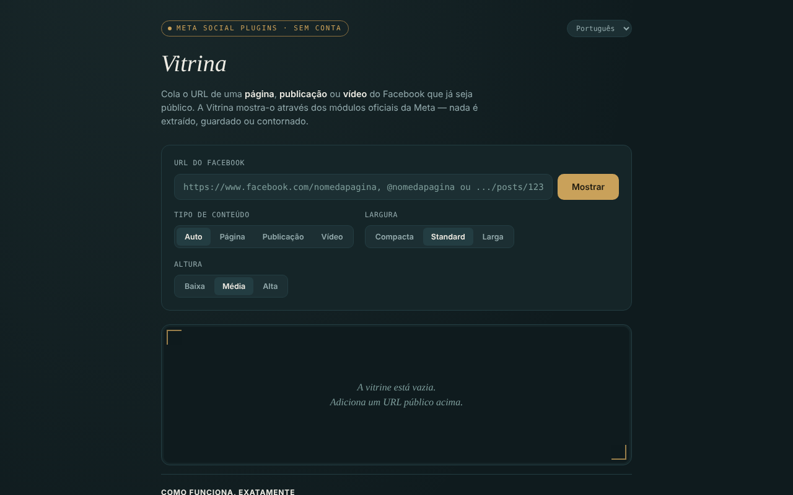

# Vitrina

[English](README.md) · [Română](README.ro.md) · [Français](README.fr.md) · [Italiano](README.it.md) · [Español](README.es.md) · **Português** · [Deutsch](README.de.md) · [Magyar](README.hu.md)

**Versão:** 1.2.2 · **Última atualização:** 2026-10-22

Idiomas da interface: **Română, English, Français, Italiano, Español, Português (PT), Deutsch, Magyar**

Apresenta páginas, publicações e vídeos públicos do Facebook num único ficheiro HTML, através dos módulos oficiais da Meta (Social Plugins), sem conta, em 8 idiomas.

**Aplicação online:** https://chiuta.github.io/Vitrina/

## O que é

Cola um URL do Facebook já público e a aplicação constrói um `<iframe>` para `plugins/page.php`, `plugins/post.php` ou `plugins/video.php` em `www.facebook.com`. Interface: romeno, inglês, francês, italiano, espanhol, português, alemão, húngaro. É um projeto pessoal, não oficial, sem qualquer ligação à Meta.

## Funcionalidades

- Deteção automática do tipo (página / publicação / vídeo, incluindo reels), ou escolha manual.
- Escolha da largura (Compacto 340, Padrão 500, Largo 620) e da altura (500, 700, 900); a largura adapta-se a ecrãs estreitos, e o Page Plugin está limitado a 500.
- Validação do URL: apenas `facebook.com`, `fb.watch`, `fb.com` (com os prefixos `www.`/`m.`/`web.`), `http(s)`, sem utilizador/palavra-passe no URL; domínios como `facebook.com.evil.tld` ou `facebook.com@evil.tld` são rejeitados (verificado com um teste automático).
- Mensagem explícita para Grupos, Eventos e Marketplace (não existe módulo oficial para a sua cronologia).
- Histórico das últimas 8 visualizações, apenas na memória do separador; uma etiqueta com o tipo, a origem e a hora, mais uma ligação «abrir em facebook.com» (`rel="noopener noreferrer"`).
- A mudança de idioma não recarrega o embed.
- **Nomes com @:** `@nomedapagina` é aceite como abreviatura de `https://www.facebook.com/nomedapagina`.
- Após um URL inválido ou vazio, a vitrina é esvaziada, para que a etiqueta (tipo/origem) não permaneça da visualização anterior.
- **Copiar o código iframe:** após a apresentação, um botão coloca na área de transferência o código `<iframe>` pronto a colar no seu próprio site (funciona também sem rede).
- **Ligação Vitrina:** «copiar a ligação da Vitrina» produz uma ligação com `#u=…` (URL, tipo, largura, altura). Ao ser aberta, a ligação apenas **preenche previamente** os campos; nada é carregado da Meta até premir «Mostrar». A parte depois de `#` não é enviada a nenhum servidor.
- **Colagem tolerante:** se colar um texto inteiro (por ex., uma mensagem de partilha), é extraído o primeiro URL de facebook.com / fb.watch / fb.com; os parâmetros de rastreio (`fbclid`, `mibextid`, `utm_*`, etc.) são removidos do URL antes da apresentação.

## Como se utiliza

1. Copie o URL de uma página, publicação ou vídeo do Facebook que seja público.
2. Cole-o no campo «URL do Facebook» e prima «Mostrar».
3. Opcionalmente, escolha o tipo, a largura e a altura antes de mostrar.
4. Para rever um URL, clique nele em «Visualizados nesta sessão».
5. «esvaziar a vitrina» limpa o que está apresentado.
6. Se a vitrina ficar vazia, um bloqueador de anúncios ou a Meta podem recusar a apresentação (por exemplo, exigindo autenticação); utilize a ligação «abrir em facebook.com».

## Privacidade e rede

**Sem conta ≠ sem rastreio.**

- Armazenamento: não se utilizam `localStorage`, `sessionStorage`, cookies nem IndexedDB; o histórico existe apenas na memória do separador.
- Anfitrião contactado, apenas ao premir «Mostrar»: `www.facebook.com` (o iframe do módulo). A Meta recebe o seu endereço IP, os dados do navegador e o URL visualizado, e pode definir cookies no iframe, de acordo com as suas políticas. O Referrer enviado limita-se à origem (`strict-origin-when-cross-origin`).
- A página tem uma política CSP (`meta http-equiv`) que permite frames apenas para `facebook.com`; o script próprio é autorizado por um hash SHA-256 (sem `'unsafe-inline'` em `script-src`); não tem scripts nem recursos externos. O carregamento real dos módulos da Meta não pôde ser testado a partir do ambiente de desenvolvimento (sem acesso à rede).
- Sem análise de utilização; a aplicação não envia dados para mais lado nenhum. Não pede permissões ao navegador.

## Limites e avisos

- Os módulos iframe nunca exigiram um token da sua parte; em separado, a Meta anunciou a 15 de junho de 2026 o acesso sem token às API oEmbed (a Vitrina não as utiliza) — segundo o blogue para programadores da Meta, à data de redação; consulte a documentação oficial.
- Aplicam-se os Termos da Plataforma Meta; utilize os módulos apenas para apresentação.
- O Facebook pode exigir autenticação ou recusar a apresentação de alguns conteúdos; o que se vê depende da Meta, não da aplicação.
- As publicações de Grupos/Eventos públicos são assinaladas «não confirmado oficialmente pela Meta».
- Os embeds não estão isolados com `sandbox` (não foi possível testar o funcionamento dos módulos da Meta num sandbox).

## Execução local / offline

Descarregue `index.html` e abra-o num navegador. Sem internet a interface carrega, mas os embeds não são apresentados.

## Licença

MIT — ver o ficheiro LICENSE (o README dizia anteriormente que a licença não estava declarada, embora o ficheiro exista no repositório).

## Autor

Alexio — Alexandru-Ionuț Chiuță, contacto: alexio@trom.tf

## Resumo

A Vitrina («montra») é uma página de um único ficheiro que apresenta páginas, publicações e vídeos públicos do Facebook através dos iframes oficiais dos Social Plugins da Meta, sem conta, em 8 idiomas. O URL é validado (apenas facebook.com / fb.watch / fb.com, sem credenciais). Nada é armazenado, sem análise de utilização, mas a Meta carrega diretamente o conteúdo, pelo que vê o seu IP e o URL que visualiza: sem conta não é o mesmo que sem rastreio. Licença: MIT, ver LICENSE.

## Fontes verificadas em 11.10.2026

- Anúncio da Meta de 15 de junho de 2026 sobre o acesso sem token às API oEmbed: https://developers.facebook.com/blog/post/2026/06/15/tokenless-access-to-meta-oembed-apis/ (existência do anúncio confirmada; a Vitrina não utiliza oEmbed).

## Histórico / Changelog

### 1.2.2 — 2026-10-22
- fff-kit 1.1.2: PBKDF2 com 600.000 iterações, proteção anti-clickjacking.

### 1.2.1 — 2026-10-22
- Deteção de falha do embed: se o quadro da Meta não indicar o carregamento em 12 segundos, surge uma mensagem (bloqueador, página não pública ou sem resposta) com ligação direta ao facebook.com.
- Telemóvel: nenhum texto abaixo de 12 px e áreas táteis de pelo menos 24 px (WCAG 2.5.8).

- 1.1.0 — 2026-10-14: cópia de segurança e etiquetagem de dados (fff-kit).

- 1.0.0 — 2026-10-12: a versão e a data da última atualização são apresentadas na aplicação
- **11 de outubro de 2026** (ronda 7) — `script-src` com hash em vez de `'unsafe-inline'`; `@nomedapagina` aceite; após um URL inválido/vazio a vitrina é esvaziada (sem etiqueta obsoleta); texto de exemplo atualizado em 7 idiomas; testado (0 erros, axe 0 violações a 1280×800 e 360×740).
- **11 de outubro de 2026** — botões «copiar o código iframe» e «copiar a ligação da Vitrina» (preenchimento prévio através de `#u=`, sem carregamento automático), extração do URL a partir do texto colado e remoção dos parâmetros de rastreio; textos nos 7 idiomas; testado (0 erros JS, axe-core 0 violações a 1280×800 e 360×740).
- **11 de outubro de 2026** — o conteúdo da página está agora envolvido numa região `<main>` (header / main / footer), pelo que o axe-core dá 0 violações a 1280×800 e 360×740; README alinhado com o ficheiro LICENSE existente; verificado que a apresentação de um embed constrói o iframe e que não surgem erros JS. A aplicação não tinha número de versão.
